<div align="center">


# dropit

**跨设备实时传递文本和文件的自托管云剪贴板**

网页、命令行与临时房间共用一套实时 API：在一台设备上粘贴，其他设备立即看到。

[](https://hub.docker.com/r/lthero1/dropit)
[](https://hub.docker.com/r/lthero1/dropit)

[](https://lthero-big.github.io/dropit/)
[](LICENSE)

**[📖 文档站](https://lthero-big.github.io/dropit/)** · [快速开始](https://lthero-big.github.io/dropit/start/getting-started/) · [部署](https://lthero-big.github.io/dropit/deploy/deployment/) · [配置](https://lthero-big.github.io/dropit/config/configuration/) · [API](https://lthero-big.github.io/dropit/api/overview/) · [English docs](https://lthero-big.github.io/dropit/en/)

</div>

---

## 主要特性

| 领域 | 能力 |
| --- | --- |
| 剪贴板 | 文本 / 文件条目、WebSocket 实时同步、就地编辑、Markdown 安全渲染、标签、置顶、分组、来源设备、Ctrl/⌘ K 命令面板 |
| 文件 | WebP 缩略图与预览、视频/音频内联播放、`Range` 断点下载、分片续传上传 |
| 分享 | 有时限、可限次、可撤销的只读链接；无需账号的临时房间（≤ 24 小时，一个房间码即短链接 `/r/<房间码>`，可选 PIN，二维码加入）；用户可以生成个人邀请 |
| 账号 | 邮箱 + 密码（scrypt）与 GitHub / Google OAuth、首次运行 /setup 初始化码、注册策略（关闭 / 仅邀请 / 开放）、管理员重置密码、个人访问令牌、设备码登录 |
| 管理 | 用户、邀请、令牌、登录设备、运行时限额（即时生效 + 审计）、新版本提示 |
| 命令行 | `dropit` CLI：发送、上传、下载、分享、`watch` 实时监听、临时房间 |
| 运维 | 单进程 Node + SQLite（WAL）+ 本地磁盘；单 Docker 镜像；`/healthz` |

## 截图

> 截图全部来自一个只填充了虚构示例数据的临时实例（`demo@example.com`、示例文件与房间），不含任何真实数据；可用 [`scripts/screenshots.mjs`](scripts/screenshots.mjs) 一键重新生成，说明见 [`docs/screenshots/`](docs/screenshots/)。

<table>
  <tr>
    <td align="center">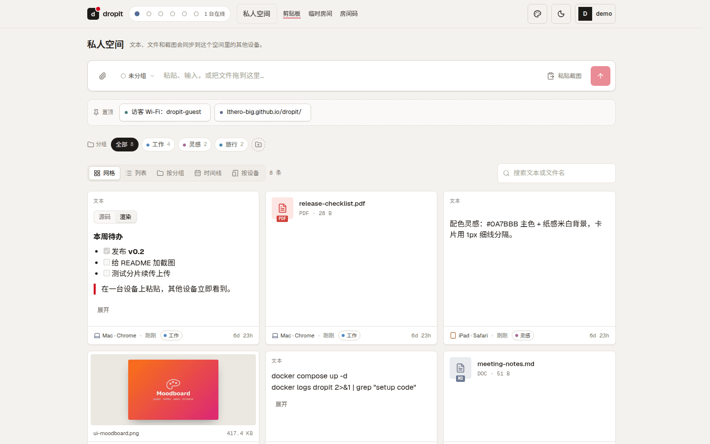<br /><sub>剪贴板：文本 / 图片 / 文件、分组、置顶、来源设备</sub></td>
    <td align="center">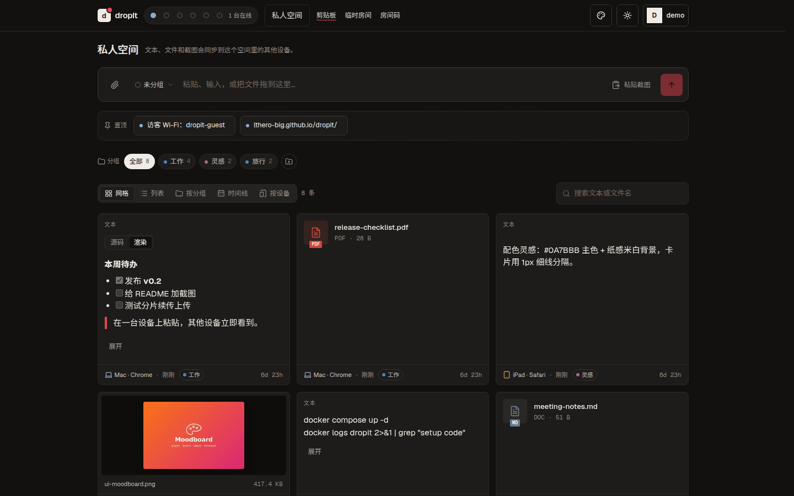<br /><sub>深色主题（另有 Bento / Swiss / 终端 界面风格）</sub></td>
  </tr>
  <tr>
    <td align="center">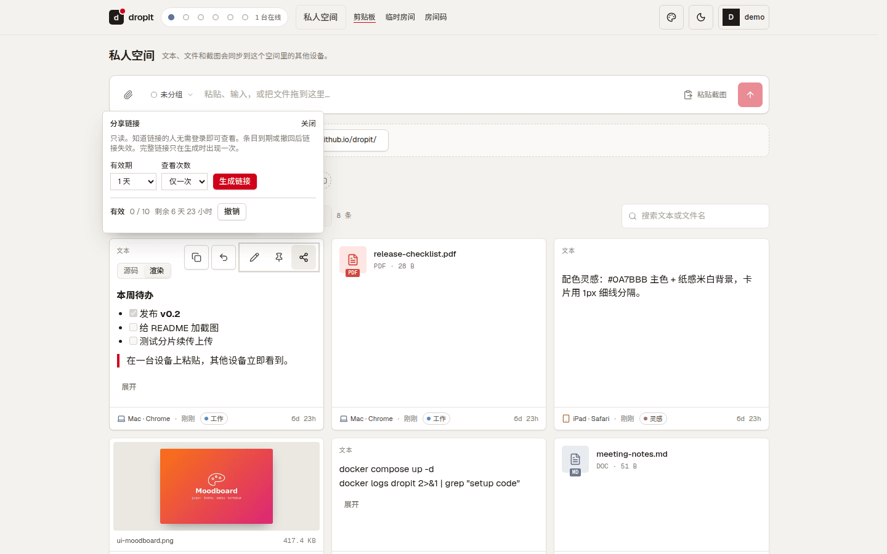<br /><sub>分享链接：有效期 + 查看次数，可随时撤销</sub></td>
    <td align="center">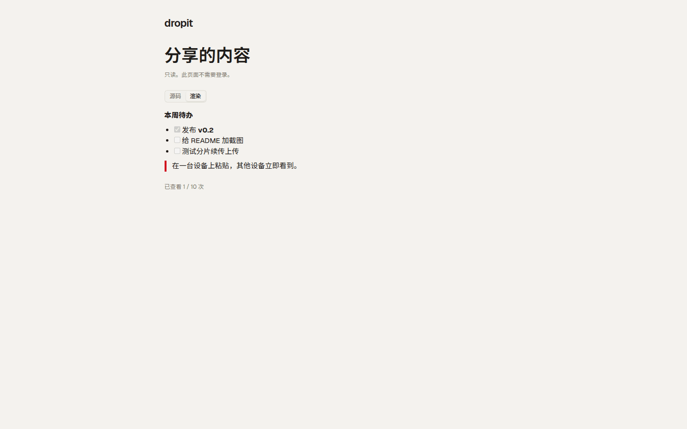<br /><sub>接收方打开分享链接，无需登录</sub></td>
  </tr>
  <tr>
    <td align="center">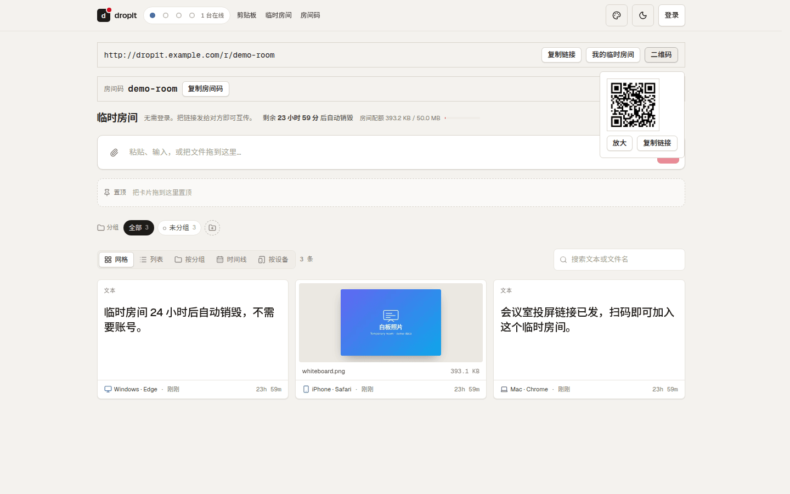<br /><sub>临时房间：房间码即短链接 /r/&lt;房间码&gt;，扫码加入</sub></td>
    <td align="center">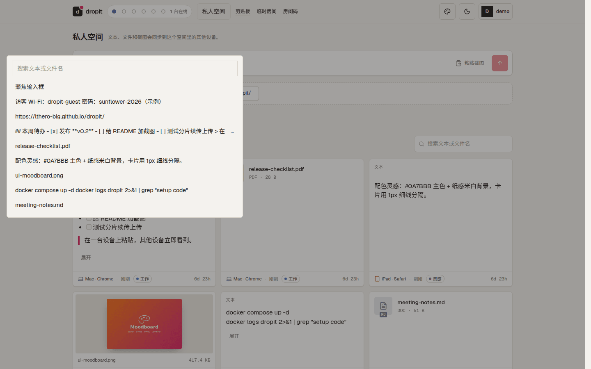<br /><sub>Ctrl / ⌘ K 命令面板，快速查找条目</sub></td>
  </tr>
  <tr>
    <td align="center">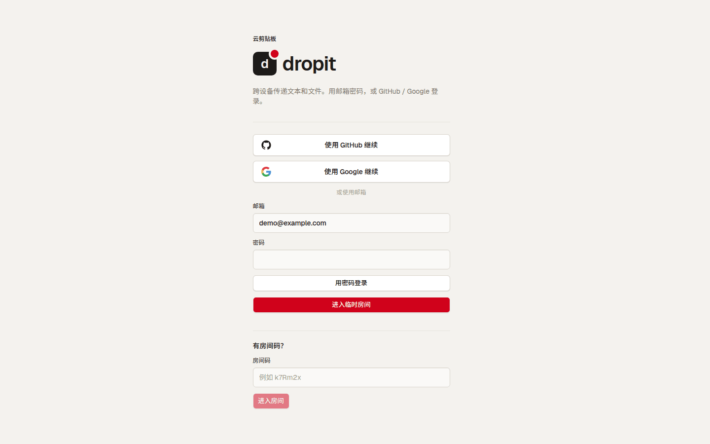<br /><sub>登录：邮箱密码、GitHub / Google，或直接进入临时房间</sub></td>
    <td align="center">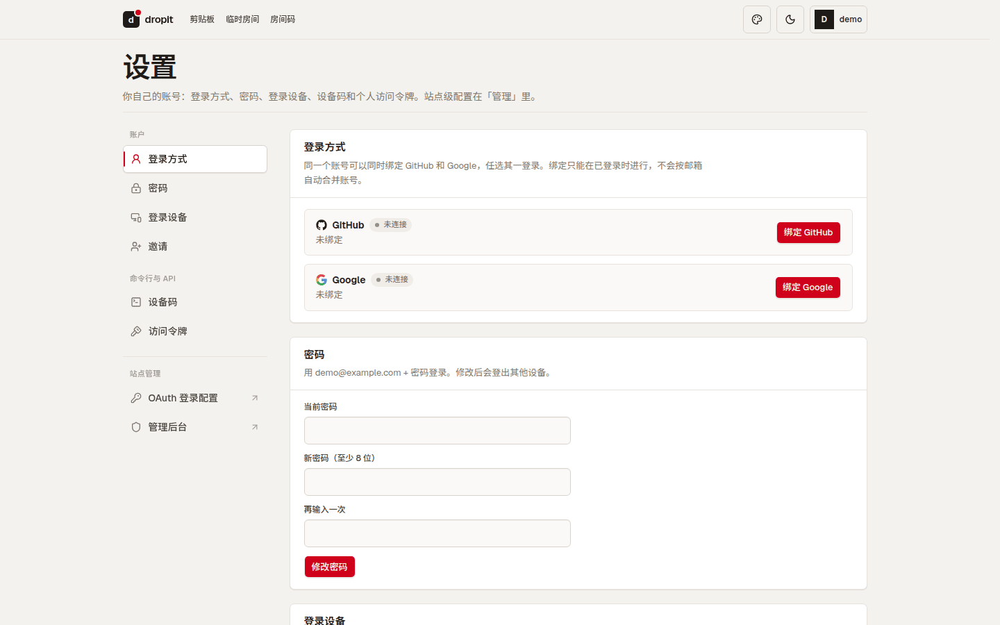<br /><sub>设置：登录方式、密码、登录设备、设备码、访问令牌</sub></td>
  </tr>
  <tr>
    <td align="center">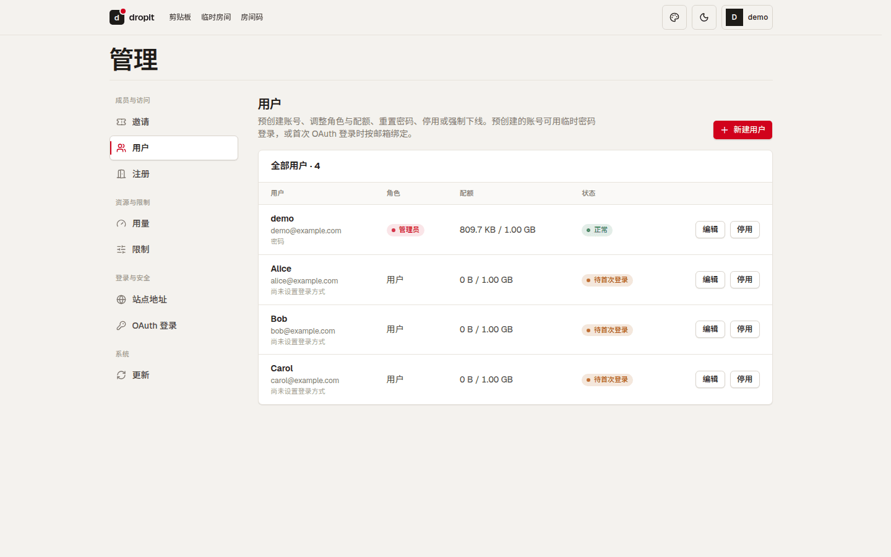<br /><sub>管理 → 用户：预创建、角色、配额、停用</sub></td>
    <td align="center">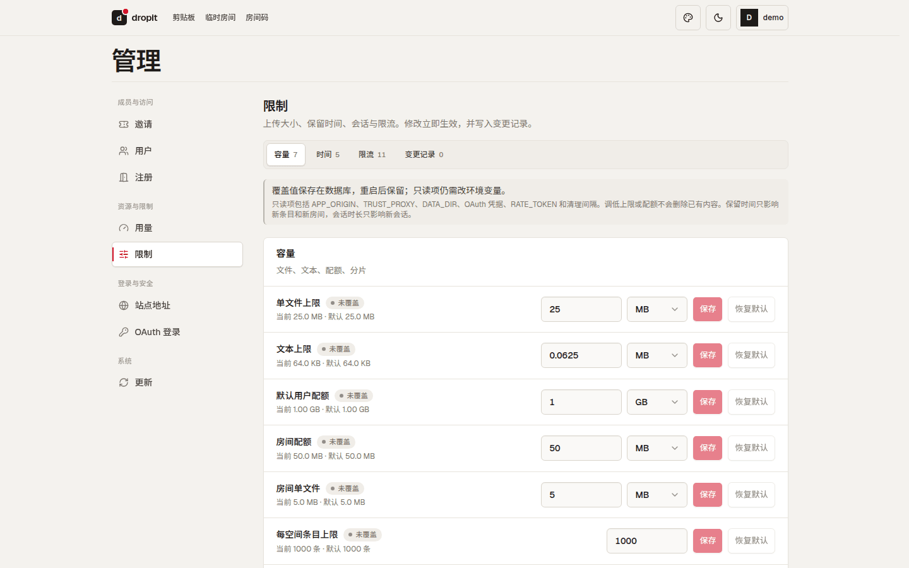<br /><sub>管理 → 限制：运行时限额即时生效并留审计</sub></td>
  </tr>
</table>

<p align="center">
  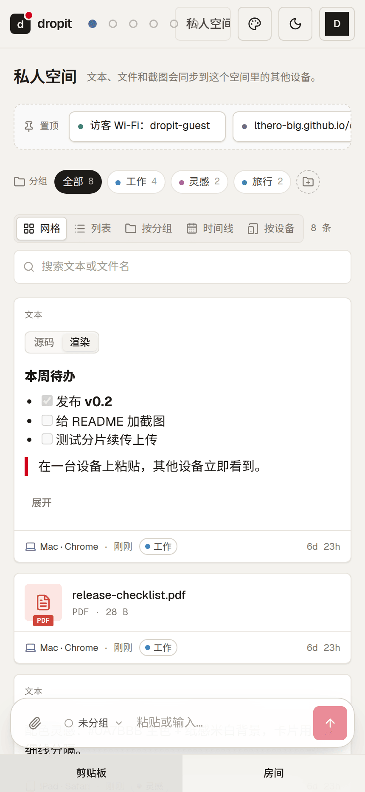
  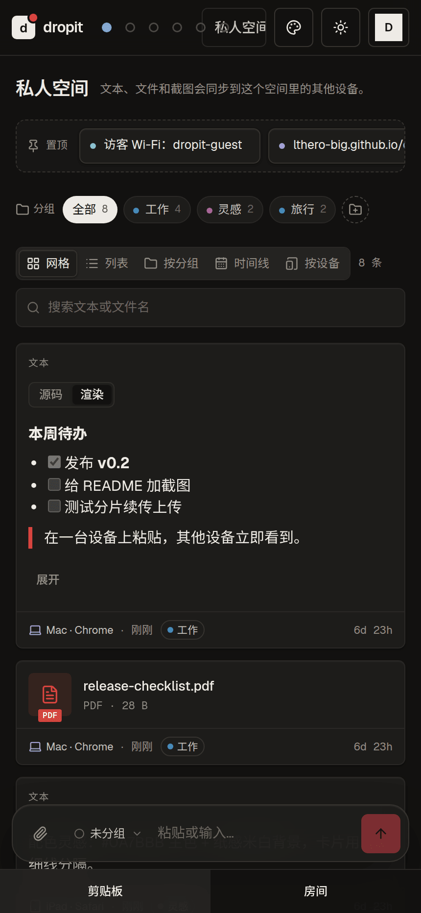
  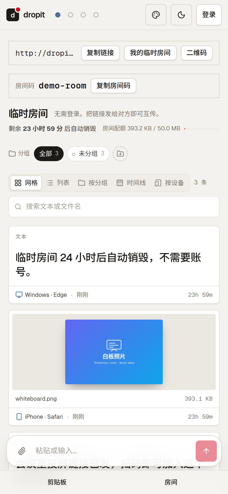
  <br /><sub>手机端：浅色 / 深色剪贴板与临时房间</sub>
</p>

## 快速开始

### Docker（推荐）

```bash
docker run -d --name dropit \
  -p 127.0.0.1:8787:8787 \
  -v dropit-data:/data \
  lthero1/dropit:latest
```

也可以用仓库里的 `docker compose up -d`：配置放在可选的 `.env`（`cp .env.example .env`，文件里分了必填 / 推荐 / 可选，并标出哪些能在管理后台改）。

### 首次运行：创建管理员

```bash
docker compose up -d                      # 或上面的 docker run
docker logs dropit 2>&1 | grep 'setup code'
# dropit setup code: K7QM-4XHT
```

打开 <http://localhost:8787>，会自动跳到 `/setup`：填入日志里的初始化码、管理员邮箱和密码（至少 8 位），即完成初始化并登录。初始化码每次启动重新生成，只在还没有任何账号时有效。不需要任何其他环境变量：未设置 `APP_ORIGIN` 时按浏览器访问的地址自动处理，之后可在「管理 → 站点地址」固定。

不想开浏览器？在 `.env` 里同时设 `ADMIN_EMAIL` 和 `ADMIN_PASSWORD`，数据库为空时启动即创建该管理员并跳过 `/setup`（之后可删掉 `ADMIN_PASSWORD`）。

忘记密码：`docker exec dropit dropit-admin reset-password 你的邮箱`，会打印一个临时密码，登录后必须立即修改。

### 启用 GitHub / Google 登录（可选）

成对设置 `GITHUB_CLIENT_ID` / `GITHUB_CLIENT_SECRET`（或 `GOOGLE_CLIENT_ID` / `GOOGLE_CLIENT_SECRET`），回调地址为 `${APP_ORIGIN}/api/auth/github/callback`（或 `.../google/callback`），「管理 → 站点地址」会直接列出可复制的回调地址，也可以直接在「管理 → OAuth 登录」填写。密码账号可以在「设置 → 登录方式」绑定 GitHub / Google。若 OAuth 在初始化前就已通过环境变量配好，用户表为空时**第一个成功 OAuth 登录的人也会成为管理员**（不需要初始化码），所以公网部署请先完成 `/setup`。新账号默认**仅邀请**，可在「管理 → 注册」改为关闭或开放。

### 生产部署

镜像默认 `NODE_ENV=production`。设 `APP_ORIGIN=https://你的域名`（或登录后在「管理 → 站点地址」填写，页面设置优先于环境变量），容器只绑定 `127.0.0.1:8787`，由 nginx 等反向代理终止 TLS 并转发 WebSocket；`TRUST_PROXY` 填反代地址（如 `loopback`）。完整的 compose、nginx、升级与备份说明见 [部署文档](https://lthero-big.github.io/dropit/deploy/deployment/)。

从源码构建的 compose 部署用 `./scripts/update.sh --docker` 升级：它会沿用正在运行的容器所用的 compose 文件（也可 `--compose-file compose.prod.yml`；仓库里的 `compose.prod.yml` 不含域名和凭据，`APP_ORIGIN`、`TRUST_PROXY` 写在 `.env`），升级前自动备份数据，发现会换到另一个数据卷时直接拒绝，升级后自检失败会自动切回旧镜像。先用 `--dry-run` 看计划。

### 从源码运行

```bash
pnpm install          # Node.js 22+，pnpm 11
cp .env.example .env
pnpm dev              # http://localhost:5173
```

### 命令行

CLI 发布在 GitHub Packages，即使是公开包也需要认证。先在 `~/.npmrc` 里配置（令牌是具有 `read:packages` 权限的 GitHub 个人访问令牌）：

```ini
# ~/.npmrc
@lthero-big:registry=https://npm.pkg.github.com
//npm.pkg.github.com/:_authToken=<具有 read:packages 权限的 GitHub 个人访问令牌>
```

```bash
npm install -g @lthero-big/dropit-cli   # 首次发布之后可用；命令名是 dropit
dropit login --url https://dropit.example.com
```

发布之前可以从源码安装：`pnpm install && pnpm --filter @lthero-big/dropit-cli build && npm install -g ./apps/cli`。详见 [命令行](https://lthero-big.github.io/dropit/start/cli/)。

## 文档

完整文档在 **<https://lthero-big.github.io/dropit/>**（源文件在 [`site/`](site/)）：

- [快速开始](https://lthero-big.github.io/dropit/start/getting-started/) · [使用指南](https://lthero-big.github.io/dropit/start/user-guide/) · [命令行](https://lthero-big.github.io/dropit/start/cli/)
- [部署](https://lthero-big.github.io/dropit/deploy/deployment/) · [管理后台](https://lthero-big.github.io/dropit/deploy/administration/) · [安全模型](https://lthero-big.github.io/dropit/deploy/security/)
- [配置](https://lthero-big.github.io/dropit/config/configuration/) · [后端配置参考](https://lthero-big.github.io/dropit/config/backend-config/)
- [API 概览](https://lthero-big.github.io/dropit/api/overview/) · [API 契约](https://lthero-big.github.io/dropit/api/reference/)
- [架构](https://lthero-big.github.io/dropit/dev/architecture/) · [开发与贡献](https://lthero-big.github.io/dropit/dev/development/) · [常见问题](https://lthero-big.github.io/dropit/faq/)

## 许可证

[GNU AGPL-3.0-only](LICENSE)：可以免费使用、修改、分发和商用；分发修改版，或把修改版作为网络服务提供给他人时，须以 AGPL-3.0 公开完整源代码。详见 [常见问题](https://lthero-big.github.io/dropit/faq/)。
