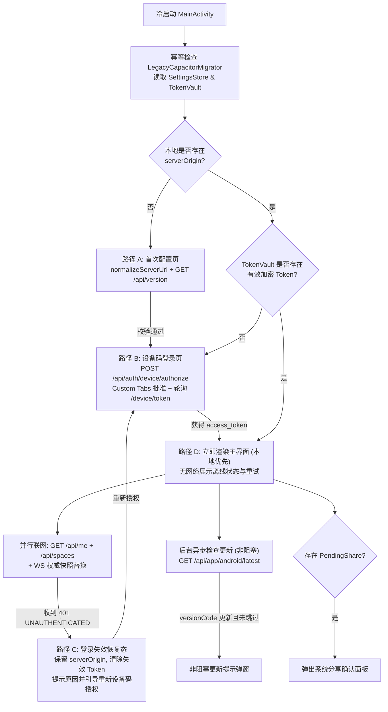
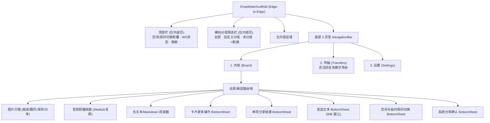
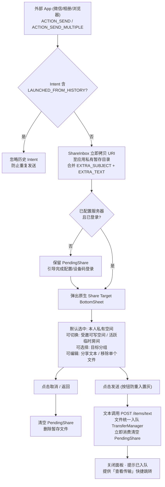

# dropit Android 原生客户端 UI/UX 设计规范、纸感 Token 映射与功能对照契约

> **文档角色**：RHEA-225（dropit Android 原生重做）Stage 1B 唯一设计基准与契约文档。供 Stage 2（核心 UI 闭环）、Stage 3（完整功能 UI 补齐）及 Stage 4（全功能对照验收与边界打磨）直接消费与逐项校验。  
> **代码核对基线**：`feat/rhea-225-android-native`（继承自 `main@37ce06e`）。本文档中所有颜色 Token、API 路径与 `browserSession()` 权限边界均已逐项核对当前仓库源码。  
> **适用范围**：`apps/android/`（包名 `dev.dropit.app`，Kotlin + Jetpack Compose + Material 3，`minSdk = 23` / `targetSdk = 35`）。

---

## 目录

1. [纸感（Paper）设计系统 Compose Token 映射](#1-纸感paper设计系统-compose-token-映射)
   - [1.1 视觉基调与皮肤策略](#11-视觉基调与皮肤策略)
   - [1.2 纸感全量颜色 Token 映射表（Light / Dark）](#12-纸感全量颜色-token-映射表light--dark)
   - [1.3 语义补充色、文件类型徽标色与分组色相规则](#13-语义补充色文件类型徽标色与分组色相规则)
   - [1.4 Material 3 ColorScheme 与 DropitExtendedColors 契约](#14-material-3-colorscheme-与-dropitextendedcolors-契约)
   - [1.5 字体与字号层级（支持系统大字体缩放）](#15-字体与字号层级支持系统大字体缩放)
   - [1.6 圆角、描边与阴影策略](#16-圆角描边与阴影策略)
   - [1.7 动效时长、曲线与减弱动效降级](#17-动效时长曲线与减弱动效降级)
2. [手机优先信息架构与页面流程](#2-手机优先信息架构与页面流程)
   - [2.1 本地优先冷启动流程（四条路径）](#21-本地优先冷启动流程四条路径)
   - [2.2 主导航结构与全局系统返回手势栈](#22-主导航结构与全局系统返回手势栈)
   - [2.3 内容页（Board）](#23-内容页board)
   - [2.4 传输页（Transfers）](#24-传输页transfers)
   - [2.5 系统分享确认面板（Share Target Sheet）](#25-系统分享确认面板share-target-sheet)
   - [2.6 多媒体与内容查看器（灯箱 / 音视频 / Markdown）](#26-多媒体与内容查看器灯箱--音视频--markdown)
   - [2.7 临时房间与单项分享弹窗](#27-临时房间与单项分享弹窗)
   - [2.8 设置与非阻塞更新页](#28-设置与非阻塞更新页)
3. [全功能对照与接口权限边界表（Parity Matrix）](#3-全功能对照与接口权限边界表parity-matrix)
   - [3.1 Web 端与旧版 Android 全能力对照矩阵](#31-web-端与旧版-android-全能力对照矩阵)
   - [3.2 browserSession() / adminBrowser() 服务端鉴权边界明细](#32-browsersession--adminbrowser-服务端鉴权边界明细)
4. [Android 交互细节与 Stage 4 验收检查清单](#4-android-交互细节与-stage-4-验收检查清单)
   - [4.1 平台级交互与无障碍规范](#41-平台级交互与无障碍规范)
   - [4.2 Stage 4 逐项验收检查清单](#42-stage-4-逐项验收检查清单)

---

## 1. 纸感（Paper）设计系统 Compose Token 映射

### 1.1 视觉基调与皮肤策略

- **核心基准**：对齐 `apps/web/src/index.css`（L9–L191）定义的默认**纸感（Paper）**设计系统：
  - **浅色纸感（Light）**：温润的纸面底色（`#F4F2EE`）与纯白卡片（`#FFFFFF`）形成温和层次，以低饱和暖灰极细边框（`#E7E3DC` / `#D9D4CB`）界定结构，朱红品牌色（`#D0021B`）克制地用于主操作、活跃态与危险操作，墨绿（`#2F7D4F`）承载成功与已复制反馈。
  - **深色纸感（Dark）**：暖炭黑画布（`#121110`）与阶梯炭灰表面（`#171615` / `#1D1C1A` / `#252321`），**绝不使用纯黑（`#000000`）作为画布或卡片底色**，边框为极细暖炭描边而非刺眼纯白线条，品牌色提亮为 `#F0434F` 以维持暗底可读性。
- **可选皮肤核对（`apps/web/src/skins.css`）**：
  - Web 端在 `apps/web/src/skins.css` 中额外提供了三套可选皮肤：`bento`（L11–L65，`--radius: 14px`、蓝主色 `#3048d8`/`#7b8cff`）、`swiss`（L68–L128，`--radius: 0px`、高对比黑框 `#111111`/`#f5f5f5`、红主色 `#d0021b`/`#ff3b47`）、`terminal`（L131–L202，`--radius: 2px`、等宽字体、荧光绿 `#0b7a3a`/`#3dff8b`、虚线边框）。
  - **Android 原生首版（`0.4.0`）策略**：锁定**纸感（Paper）**明暗两套配色 + 跟随系统模式，确保视觉与组件边界高度统一；所有主题颜色统一经 `DropitTheme` / `LocalDropitColors` 注入，不把色值硬编码到业务页面，为后续若需扩展皮肤保留 Token 替换层。

### 1.2 纸感全量颜色 Token 映射表（Light / Dark）

源码依据：`apps/web/src/index.css`（Light: L96–L123；Dark: L125–L152；Semantic: L155–L191）。

| 分组 | CSS 变量 | Compose 字段名 | Light Hex / Color | Dark Hex / Color | 用途说明 |
| --- | --- | --- | --- | --- | --- |
| **背景与层级** | `--bg` | `bg` | `#F4F2EE` (`0xFFF4F2EE`) | `#121110` (`0xFF121110`) | 页面主画布背景 |
| | `--surface-0` | `surface0` | `#FAF9F7` (`0xFFFAF9F7`) | `#171615` (`0xFF171615`) | 顶部栏、底部导航栏、输入框底色、次级面板底色 |
| | `--surface-1` | `surface1` | `#FFFFFF` (`0xFFFFFFFF`) | `#1D1C1A` (`0xFF1D1C1A`) | 剪贴板卡片、弹窗、ModalBottomSheet 主容器 |
| | `--surface-2` | `surface2` | `#F0EDE8` (`0xFFF0EDE8`) | `#252321` (`0xFF252321`) | 悬浮/按压态填充、次级按钮、芯片底色、进度条轨道 |
| | `--surface-sunken` | `surfaceSunken` | `#EBE8E2` (`0xFFEBE8E2`) | `#0E0D0C` (`0xFF0E0D0C`) | 图片缩略图底托、内凹容器、骨架屏高亮过渡色 |
| **描边与文字** | `--line-1` | `line1` | `#E7E3DC` (`0xFFE7E3DC`) | `#2A2826` (`0xFF2A2826`) | 卡片默认边框、卡片内部分割线、导航栏边线 |
| | `--line-2` | `line2` | `#D9D4CB` (`0xFFD9D4CB`) | `#36332F` (`0xFF36332F`) | 按钮/输入框/弹层边框、分组胶囊边框 |
| | `--line-3` | `line3` | `#BDB6AA` (`0xFFBDB6AA`) | `#4D4943` (`0xFF4D4943`) | 聚焦/强调边框、开关未开启轨道、虚线操作边 |
| | `--fg` | `fg` | `#1D1B18` (`0xFF1D1B18`) | `#EEEBE6` (`0xFFEEEBE6`) | 一级主文字、标题、选中芯片反色底 |
| | `--fg-2` | `fg2` | `#4A4640` (`0xFF4A4640`) | `#C7C2BA` (`0xFFC7C2BA`) | 二级正文、设备名、操作图标默认色 |
| | `--fg-3` | `fg3` | `#7D776D` (`0xFF7D776D`) | `#958F85` (`0xFF958F85`) | 三级辅助文字、时间戳、次要标签、文件元信息 |
| | `--fg-4` | `fg4` | `#A59F94` (`0xFFA59F94`) | `#6C675F` (`0xFF6C675F`) | 占位提示符、代码行号、禁用态与暂停进度条 |
| **品牌与语义** | `--brand` | `brand` | `#D0021B` (`0xFFD0021B`) | `#F0434F` (`0xFFF0434F`) | 主行动按钮（发送/确认）、进度条主色、活跃指示器、临期高亮 |
| | `--brand-fg` | `brandFg` | `#FFFFFF` (`0xFFFFFFFF`) | `#160707` (`0xFF160707`) | 品牌色实心按钮上的文字与图标 |
| | `--brand-soft` | `brandSoft` | `brand.copy(alpha = 0.10f)` (`#1AD0021B`) | `brand.copy(alpha = 0.14f)` (`#24F0434F`) | 品牌/错误胶囊柔底、只读或警告提示条底色（Web 源 `color-mix 10%`，Dark 适度提至 14% 保证可见度） |
| | `--ok` | `ok` | `#2F7D4F` (`0xFF2F7D4F`) | `#5CC28A` (`0xFF5CC28A`) | 复制成功、WS 已连接、传输完成、状态正常 |
| | `--ok-soft` | `okSoft` | `ok.copy(alpha = 0.14f)` (`#242F7D4F`) | `ok.copy(alpha = 0.16f)` (`#295CC28A`) | 成功状态胶囊背景 |
| | `--code-bg` | `codeBg` | `#F6F4F0` (`0xFFF6F4F0`) | `#151413` (`0xFF151413`) | 代码块、行内代码、设备码/房间码展示容器 |
| | `--destructive` | `destructive` | `#D0021B` (`0xFFD0021B`) | `#F0434F` (`0xFFF0434F`) | 撤回、撤销、登出、传输失败报错（对齐 `index.css:174`，与 `brand` 同源） |
| | `--ring` | `focusRing` | `brand.copy(alpha = 0.55f)` (`#8CD0021B`) | `brand.copy(alpha = 0.55f)` (`#8CF0434F`) | 键盘焦点外环（对齐 `index.css:177`） |
| | *(语义警告)* | `warn` | `#B45309` (`0xFFB45309`) | `#E0A165` (`0xFFE0A165`) | 配额预警（`quotaTone == warn`）、WS 重连中、只读/待验证警告态（源码：`settings-ui.tsx:225`、`clipboard-board.tsx:550`） |
| | *(语义警告柔底)* | `warnSoft` | `warn.copy(alpha = 0.14f)` (`#24B45309`) | `warn.copy(alpha = 0.16f)` (`#29E0A165`) | 警告胶囊与离线提示横幅背景 |
| **设备标识色** | `--dev-mac` | `devMac` | `#6B6A8F` (`0xFF6B6A8F`) | `#A3A1D6` (`0xFFA3A1D6`) | `mac` 设备徽标与发送者标识 |
| | `--dev-phone` | `devPhone` | `#3F7F74` (`0xFF3F7F74`) | `#6CC4B4` (`0xFF6CC4B4`) | `phone` 设备徽标（Android/iOS 手机） |
| | `--dev-pad` | `devPad` | `#A86B2D` (`0xFFA86B2D`) | `#E0A165` (`0xFFE0A165`) | `pad` 设备徽标与临时房间访客标识 |
| | `--dev-pc` | `devPc` | `#4D6F9C` (`0xFF4D6F9C`) | `#86A9D8` (`0xFF86A9D8`) | `pc` 与 `cli` 设备徽标（`apps/web/src/lib/device.ts:113` 规定 `cli` 复用 `devPc`） |

### 1.3 语义补充色、文件类型徽标色与分组色相规则

1. **文件类型徽标色**（核对 `apps/web/src/lib/file-type.ts:4-20`）：
   - `PDF`: `#D0453A` (`0xFFD0453A`)、`ARCHIVE`: `#A07A2C` (`0xFFA07A2C`)、`AUDIO`: `#8A5CC2` (`0xFF8A5CC2`)、`VIDEO`: `#C2577F` (`0xFFC2577F`)、`IMAGE`: `#3F8F7A` (`0xFF3F8F7A`)、`DESIGN`: `#4F6FD0` (`0xFF4F6FD0`)、`CODE`: `#4D6F9C` (`0xFF4D6F9C`)、`DOC`: `#6B7A8F` (`0xFF6B7A8F`)、默认 `FILE`: `#7D776D` (`0xFF7D776D`)。
   - 徽标容器背景使用 `tint.copy(alpha = 0.14f)` 叠于 `surface1` 上，扩展名角标使用实色 `tint` + 白色等宽文字。
2. **分组圆点色算法**（核对 `apps/web/src/lib/groups.ts:3-10`）：
   - 固定色相：`"工作" -> 250f`、`"个人" -> 150f`；其他名称逐字符迭代 `h = (h * 37 + ch.code) % 360`。
   - Compose 端可将 `hue` 以 HSL/HCT 转换生成中明度、低饱和的纸感圆点色（Light 推荐 `HSL(h, 0.42f, 0.48f)`，Dark 推荐 `HSL(h, 0.45f, 0.65f)`，近似 Web 的 `oklch(0.6 0.11 h)`）；未分组使用 `fg4` 空心描边圆点。
3. **多媒体沉浸底色**：
   - 图片灯箱与全屏视频播放器遮罩使用深炭黑 `Color(0xF00E0D0C)`，顶/底悬浮控制栏文字使用 `Color(0xD9FFFFFF)`（主）与 `Color(0x8CFFFFFF)`（次），不受浅色主题干扰。

### 1.4 Material 3 ColorScheme 与 DropitExtendedColors 契约

Stage 2B 在 `apps/android/app/src/main/java/dev/dropit/app/ui/theme/` 中实现以下双层映射：Material 3 原生组件自动继承 `ColorScheme`，业务自定义层级（如 `surfaceSunken`、`line1/2/3`、`fg3/4`、`ok`、`warn`、`dev*`）通过 `DropitTheme.colors` 读取。

```kotlin
@Immutable
data class DropitExtendedColors(
    val isDark: Boolean,
    val bg: Color,
    val surface0: Color,
    val surface1: Color,
    val surface2: Color,
    val surfaceSunken: Color,
    val line1: Color,
    val line2: Color,
    val line3: Color,
    val fg: Color,
    val fg2: Color,
    val fg3: Color,
    val fg4: Color,
    val brand: Color,
    val brandFg: Color,
    val brandSoft: Color,
    val ok: Color,
    val okSoft: Color,
    val warn: Color,
    val warnSoft: Color,
    val destructive: Color,
    val codeBg: Color,
    val focusRing: Color,
    val devMac: Color,
    val devPhone: Color,
    val devPad: Color,
    val devPc: Color,
)
```

**Material 3 `ColorScheme` 映射规则**：

| M3 ColorScheme Slot | 映射自 `DropitExtendedColors` | 说明 |
| --- | --- | --- |
| `primary` / `onPrimary` | `brand` / `brandFg` | 主按钮、FAB、选中开关、进度条 |
| `primaryContainer` / `onPrimaryContainer` | `brandSoft` / `brand` | 轻量强调容器、活跃角标 |
| `secondary` / `onSecondary` | `fg` / `bg` | 选中态分组芯片反色填充 |
| `secondaryContainer` / `onSecondaryContainer` | `surface2` / `fg` | 底部导航选中指示器、次级按钮底色 |
| `tertiary` / `onTertiary` | `ok` / `Color.White` (Light) 或 `Color(0xFF071A10)` (Dark) | 成功态语义 |
| `background` / `onBackground` | `bg` / `fg` | 页面画布 |
| `surface` / `onSurface` | `surface1` / `fg` | 卡片与 Sheet |
| `surfaceVariant` / `onSurfaceVariant` | `surface2` / `fg3` | 输入框/辅助图标与说明 |
| `surfaceContainerLowest` | `surfaceSunken` | 缩略图凹槽 |
| `surfaceContainerLow` | `surface0` | 顶栏/底栏/输入底色 |
| `surfaceContainer` | `surface1` | 卡片主表面 |
| `surfaceContainerHigh` / `Highest` | `surface2` | 弹窗内次级块 |
| `outline` / `outlineVariant` | `line2` / `line1` | 控件边框与分割线 |
| `error` / `onError` | `destructive` / `brandFg` | 错误与危险操作 |
| `errorContainer` / `onErrorContainer` | `brandSoft` / `destructive` | 错误提示条 |
| `scrim` | `Color(0x661D1B18)` (Light) / `Color(0x99000000)` (Dark) | 弹层背景遮罩 |

### 1.5 字体与字号层级（支持系统大字体缩放）

- **字体族**：
  - 正文与标题（`DropitSans`）：系统默认无衬线（`FontFamily.SansSerif`，中文自动回退 Noto Sans CJK / 系统默认黑体，不打入超大中文字体包以控制 APK 体积）。
  - 等宽信息（`DropitMono`）：`FontFamily.Monospace`，并配置 `fontFeatureSettings = "tnum, zero"`（对齐 `clip-ui.css:35-38` 的 `.dd-mono` 与 `tabular-nums`），用于设备码、房间码、代码块、色值、文件大小、剩余倒计时、传输速度与百分比。
- **字号层级表（全部使用 `sp`，禁止 `dp` 写死文字大小）**：

| Compose Typography 角色 | 字号 / 行高 | 字重 | 字距 | 典型使用场景 |
| --- | --- | --- | --- | --- |
| `displaySmall` | `28.sp / 34.sp` | `SemiBold (600)` | `0.12em` (等宽) | 设备码登录大号 `user_code`（如 `ABCD-EFGH`） |
| `headlineSmall` | `20.sp / 27.sp` | `Medium (500)` | `-0.01em` | 短文本卡片大字展示（`<= 80` 字单行纯文本，对齐 `board-card.tsx:338`） |
| `titleLarge` | `19.sp / 26.sp` | `SemiBold (600)` | `-0.01em` | 顶部空间名、引导页主标题（对齐 `board-toolbar.tsx:34`） |
| `titleMedium` | `16.sp / 22.sp` | `SemiBold (600)` | `0.sp` | ModalBottomSheet / Dialog 标题、设置分组面板标题 |
| `bodyLarge` | `15.sp / 22.sp` | `Normal (400)` | `0.sp` | 文本输入/编辑框、长文阅读器正文、普通多行文本卡片 |
| `bodyMedium` | `14.sp / 20.sp` | `Normal (400)` | `0.sp` | 文件名、设置项标题、菜单行文案、按钮主文案 |
| `bodySmall` | `13.sp / 18.sp` | `Normal (400)` | `0.sp` | 副标题说明、错误提示、搜索框输入文案、更新说明 |
| `labelMedium` | `12.sp / 16.sp` | `Medium (500)` | `0.sp` | 分组芯片、底部导航标签、代码块正文（`12.sp` 等宽）、卡片快捷按钮标签 |
| `labelSmall` | `11.sp / 15.sp` | `Medium (500)` | `0.02em` | 卡片底部元信息（设备名、时间、剩余时长）、状态胶囊、传输速度/ETA、类型角标 |

- **大字体缩放约束（System Font Scale `1.0x–2.0x`）**：
  - 严禁为含文字的按钮、芯片、列表项写死固定 `height(32.dp)`，一律使用 `defaultMinSize(minHeight = 48.dp)` 或 `heightIn(min = ...)` 配合 `padding`。
  - 当系统字体缩放 `>= 1.3f` 时，卡片页脚元信息自动允许 `FlowRow` 换行；底部导航栏标签限制 `maxLines = 1, softWrap = false, overflow = TextOverflow.Ellipsis`；设备码展示区允许自动缩窄字距避免折行错位。

### 1.6 圆角、描边与阴影策略

对齐 `apps/web/src/index.css:76-93`（`--radius: 7px`）与 `apps/web/src/components/clip-ui.css:10-14`：

| 层级 | Compose Shape | 数值 | 使用场景 |
| --- | --- | --- | --- |
| `xs` | `RoundedCornerShape(3.dp)` | `3.dp` | 缩略图内角、文件类型小徽标、骨架块 |
| `sm` | `RoundedCornerShape(5.dp)` | `5.dp` | 卡片内小按钮、代码块容器、输入框内嵌胶囊 |
| `md`（基准） | `RoundedCornerShape(7.dp)` | `7.dp` | **剪贴板纸感卡片**、传输队列卡片、输入框、标准按钮 |
| `lg` | `RoundedCornerShape(10.dp)` | `10.dp` | 设置分组面板、文本编辑器卡片、AlertDialog |
| `sheet` | `RoundedCornerShape(topStart = 14.dp, topEnd = 14.dp)` | `14.dp` | 原生 `ModalBottomSheet` 顶部圆角 |
| `pill` | `CircleShape` | `50%` | 分组筛选芯片、状态胶囊（`StatusPill`）、在线设备圆点、发送 FAB |

- **描边与阴影策略（纸感核心特征）**：
  - **禁止 Material 3 默认的 Tonal Elevation 紫色/粉红表面染色**：统一设置 `tonalElevation = 0.dp`，所有表面层级由 `bg -> surface0 -> surface1 -> surface2` 的暖灰阶显式控制。
  - **边框**：所有卡片与输入框必须保留 `BorderStroke(1.dp, DropitTheme.colors.line1)`（悬停/聚焦/打开态切换为 `line2` 或 `line3`；复制成功瞬间切换为 `ok.copy(alpha = 0.55f)`；上传失败切换为 `destructive.copy(alpha = 0.55f)`）。
  - **阴影**：
    - `elev1`（普通卡片）：Light 使用 `shadowElevation = 1.dp`（`ambientColor`/`spotColor` = `Color(0x141D1B18)`）；Dark 使用 `0.dp` 阴影 + `1.dp` `line1` 描边。
    - `elev2`（悬浮发送条、FAB、轻弹层）：Light `3.dp`；Dark `2.dp` + `1.dp` `line2` 描边。
    - `elev3`（Dialog、`ModalBottomSheet`）：Light `8.dp`；Dark `6.dp` + `1.dp` `line2` 描边。

### 1.7 动效时长、曲线与减弱动效降级

源码依据：`apps/web/src/index.css:88-92`、`apps/web/src/lib/motion.ts:4-15`。

| Token | 时长 / 参数 | Compose 实现 | 适用场景 |
| --- | --- | --- | --- |
| `DurFast` | `120 ms` | `tween(120, easing = EaseEnter)` / `tween(120, easing = EaseExit)` | 按压缩放（`0.97f`）、图标切换（复制 → 对勾）、弹层退出、边框变色 |
| `DurBase` | `200 ms` | `tween(200, easing = EaseEnter)` | 卡片入场淡入上移（`6.dp`）、筛选列表变化、进度条平滑推进 |
| `DurSlow` | `320 ms` | `tween(320, easing = EaseEnter)` | 页面切换、全文阅读器与图片灯箱显现 |
| `EaseEnter` | `cubic-bezier(0.22, 1, 0.36, 1)` | `CubicBezierEasing(0.22f, 1f, 0.36f, 1f)` | 所有进入与展开动效 |
| `EaseExit` | `cubic-bezier(0.55, 0, 1, 0.45)` | `CubicBezierEasing(0.55f, 0f, 1f, 0.45f)` | 所有退出与收起动效 |
| `SpringSettle` | `stiffness 420 / damping 38` | `spring(dampingRatio = 0.95f, stiffness = 420f)` | 布局重排、Tab/筛选切换无过冲落位 |
| `SpringBounce` | `stiffness 520 / damping 22` | `spring(dampingRatio = 0.55f, stiffness = 520f)` | 置顶吸附、复制成功轻弹反馈 |

- **减弱动效降级**：监听系统 `Settings.Global.ANIMATOR_DURATION_SCALE`；当值为 `0f` 时，禁用位移/缩放动画，仅保留瞬间状态切换或 `snap()` 过渡（对齐 `index.css:261-274`）。

---

## 2. 手机优先信息架构与页面流程

### 2.1 本地优先冷启动流程（四条路径）

相较旧版 Capacitor 壳（`mobile/www/app.js:174-224` 串行阻塞等待 5 秒更新检查 → 请求 WebView 票据 → 加载远程网页），原生客户端采用**本地优先（Local-First）**冷启动架构：

1. **首帧零网络阻塞**：应用启动后先执行幂等的旧版数据迁移（`LegacyCapacitorMigrator` 读取旧 `CapacitorStorage` 与 `dropit_app`，仅新存储为空时迁入），立即读取本地 `SettingsStore` 与 `TokenVault`，在 `< 1 帧` 决策内渲染本地原生页面。
2. **应用更新检查完全异步**：仅在进入主界面后由后台协程发起 `GET /api/app/android/latest`（单次冷启动最多一次），无论慢网或断网均**不阻塞首页渲染与操作**。
3. **四条启动路径定义**：
   - **路径 A · 首次配置（无 `serverOrigin`）**：展示原生「连接服务器」引导页。支持输入域名自动补全 `https://`（拒绝 `http://` 与含账号密码的 URL，沿用 `mobile/www/core.js:12-22`），点击连接后调用 `GET /api/version` 校验 `semver` 与 `install` 枚举（`docker`/`docker-build`/`source`，沿用 `core.js:25-31`），页脚显示当前版本标签。
   - **路径 B · 未登录（有 `serverOrigin`，无有效 `token`）**：展示原生「设备码登录」页。自动调用 `POST /api/auth/device/authorize`（默认申请 `["read", "write"]` scope，不要求 `web`），放大显示 8 位 `user_code`（等宽防混淆），提供一键「在浏览器中批准」按钮（Chrome Custom Tabs 打开 `verification_uri_complete`），后台按 `interval` 轮询 `POST /api/auth/device/token`（处理 `authorization_pending`、`slow_down` +5s、`access_denied`、`expired_token`）。顶部提供「更换服务器」入口。
   - **路径 C · 登录失效（任意接口或 WS 鉴权收到 `401 UNAUTHENTICATED`）**：触发全局会话失效事件，立即停止 WS 重连与自动轮询，**保留当前 `serverOrigin`（不清空服务器配置）**，引导进入重登页并明确提示「当前设备的登录令牌已失效或被撤销，请重新授权」，支持一键发起新设备码流程或「更换服务器」。
   - **路径 D · 正常进入（有 `serverOrigin` 与已存 `token`）**：立即进入主导航框架（默认 `内容` 页），无网络时展示本地可读界面 + 顶部「离线 · 无法连接服务器」警告条与「重试」按钮；联网后并行请求 `GET /api/me`、`GET /api/spaces`、建立 `/api/spaces/:space/ws` 接收权威快照，并在后台异步触发更新检查。若由第三方 App 分享唤起（`PendingShare != null`），在首页就绪后直接弹出系统分享确认面板。



### 2.2 主导航结构与全局系统返回手势栈



- **底部 3 页签规范**：
  1. `内容`（默认首页）：剪贴板看板（私有空间 / 受邀空间 / 临时房间统一承载）。
  2. `传输`：上传与下载统一队列；有活跃任务（`QUEUED`/`RUNNING`）时在图标右上角展示 `brand` 色圆点或数字角标，有失败任务时显示感叹号提示。
  3. `设置`：账号信息、外观主题、系统浏览器高级入口、检查更新与登出。
- **全局系统返回手势栈规范（`BackHandler` + Android 13+ 预测性返回）**：
  按下系统返回键或触发边缘侧滑返回时，严格按以下优先级逐层消费，**禁止直接跳过弹层退出应用**：
  1. 全屏视频处于横屏全屏态 → 退出全屏回到竖屏播放器。
  2. 任意全屏查看器（图片灯箱 / 音视频播放器 / 长文阅读器）→ 关闭查看器并恢复列表滚动位置。
  3. 任意打开的 Dialog / `ModalBottomSheet`（更多菜单、分享链接、空间切换、文本发送、系统分享确认、房间码/PIN 弹窗、更新弹窗）→ 关闭最顶层弹层（若发送弹窗有未发草稿，关闭时保留草稿或提示确认）。
  4. 内容页处于搜索展开/激活态 → 清空搜索词并收起搜索输入与软键盘。
  5. 内容页当前位于**临时房间** → 退出临时房间视图并切回原私有空间。
  6. 当前位于 `传输` 或 `设置` 页签 → 切回 `内容` 页签。
  7. 当前已位于 `内容` 首页且无弹层 → 交由系统默认返回退至桌面（后台 WorkManager 传输任务继续运行，不被误取消）。

### 2.3 内容页（Board）

1. **顶部栏与连接状态**：
   - 左侧：**空间切换胶囊**（点击弹出 `ModalBottomSheet`，展示当前本人私有空间、受邀加入的空间列表及角色徽标 `我的` / `受邀 · 只读` / `受邀 · 可编辑`，下方分隔「临时房间」区块）。
   - 右侧：
     - **WS 连接状态徽标**（触控区 `>= 48.dp`）：`live` 展示 `ok` 绿点 + 在线设备数（如 `2 台在线`）；`connecting`/`reconnecting` 展示 `warn` 琥珀脉冲点 + `重连中`；断网/停止展示 `destructive` 红点 + `已离线`，点击可立即触发手动重连。
     - **搜索图标按钮**：点击展开顶部搜索框（支持按文本内容与文件名实时过滤，对齐 `use-board-filter.ts`）。
   - 二级条：**分组横向滚动芯片栏**（`全部` · 各自定义分组（带色相圆点与条目计数）· `未分组` · 仅可写空间显示 `+ 新建分组` 与当前选中分组的 `重命名/删除` 菜单；保留名 `全部`/`未分组` 禁止创建，上限 24 个，对齐 `apps/server/src/domain.ts:58-70` 与 `clipboard-board.tsx:282-338`）。
   - **置顶条（PinBar）**：当当前筛选结果存在置顶条目时，固定于列表顶部区域（`PinIcon` 标识），支持直接点击复制或打开菜单。
2. **纸感卡片信息层级**：
   - 支持 `apps/web/src/lib/clip-kind.ts` 定义的 6 种视觉形态：
     - **短纯文本**（`<= 80` 字、单行、非链接/Markdown）：`20.sp Medium` 醒目展示。
     - **长文本 / Markdown**：卡片内折叠显示前 6 行预览 + `展开` 按钮（打开全文阅读器）；含 URL 时支持点击识别。
     - **链接（`link`）**：站点首字母色块 Favicon + 标题（最多 2 行）+ 等宽去协议域名路径，点击直接用系统浏览器打开。
     - **代码（`code`）**：顶部 `代码 · <lang>` 类型角标 + `codeBg` 等宽带行号预览（默认 5 行 + 展开/阅读）。
     - **色值（`color`）**：色块卡片 + 自适应黑白反色文字（对齐 `clip-visual.tsx:75-84`）+ `rgb(...)` 换算行。
     - **图片（`image`）**：`surfaceSunken` 凹槽居中展示带 Bearer 鉴权的 Coil `/thumbnail` 缩略图，下方单行展示完整/中间省略中文文件名与文件体积；点击进入全屏图片灯箱。
     - **文件 / 音视频（`file`）**：
       - 视频：带播放遮罩的封面/视频容器，点击进入 Media3 播放器。
       - 音频：带文件类型色的内联轻播条（播放/暂停 + 进度条 + 时长）或展开全屏播放器。
       - 通用文件：文件类型色图标 + 扩展名角标（`file-type.ts`）+ 中文文件名（最多 2 行，保留末尾扩展名）+ 类型与体积（如 `PDF · 2.4 MB`）。
   - **卡片页脚元信息**：来源设备图标与颜色（`devMac`/`devPhone`/`devPad`/`devPc`）+ 设备名 · 相对时间 ·（若有修改显示 `已编辑`）· 分组胶囊 · 右对齐等宽剩余倒计时（剩余 `< 20 分钟` 触发临期 `brand` 高亮提醒，对齐 `clip-kind.ts:61`）。
   - **卡片快捷操作区（手机触控优先）**：
     - 摒弃 Web 端桌面悬停才显露按钮的做法，在卡片底部提供清晰的一行快捷操作（所有按钮 `>= 48.dp` 触控热区）：
       - 文本类卡片：**「复制」**（点击后图标弹性切换为 `ok` 绿勾并弹 Toast `已复制`，代码块自动剥离围栏 ` ``` ` 对齐 `clipboard-board.tsx:540`）、**「分享」**（系统文本分享或打开单项分享）、**「更多」**。
       - 文件/图片/媒体卡片：**「保存」**（入队 `TransferManager` 下载至系统 `Downloads`，按 RFC 5987 还原中文文件名）、**「分享」**（缓存下载后经 `FileProvider` 调起系统分享）、**「更多」**。
3. **原生 `ModalBottomSheet`「更多」菜单规范**：
   - 顶部摘要条：显示条目类型、文件名/文本首行、大小与精确过期时间。
   - 菜单项（严格按空间权限与条目类型显隐）：
     1. **编辑文本**（仅 `kind == "text"` 且 `canEdit && !readOnly`）：打开多行文本编辑 Sheet（`PATCH .../items/:id`）。
     2. **置顶 / 取消置顶**（仅 `canShare && !readOnly`）：调用 `PATCH .../items/:id/labels { pinned }`。
     3. **修改分组与标签**（仅 `canShare && !readOnly`）：内嵌或二级 Sheet 选择目标分组（`group`）及编辑标签（`tags`），调用 `PATCH .../items/:id/labels`。
     4. **生成/管理分享链接**（仅 `canShare && !readOnly`）：打开单项分享链接 Sheet（见 §2.7）。
     5. **查看全文 / 预览**（长文本或图片/视频快捷入口）。
     6. **复制下载链接**（文件条目快捷操作）。
     7. **撤回（删除）**（仅 `canRetract && !readOnly`，以 `destructive` 朱红高亮并置于底部分割线下方）：点击后**必须弹出原生二次确认 Dialog**（「确认撤回这条内容？撤回后所有设备将立即移除，且关联分享链接失效」），确认后执行 `DELETE .../items/:id`。
4. **发送入口（FAB / 底部操作条）**：
   - 可写空间在内容页右下角或列表底栏上方展示纸感主行动区（单主 FAB 或紧凑三键浮动条，自动避让底部导航栏与列表末尾）：
     - **发文本**：打开发送文本 `ModalBottomSheet`（带当前目标分组选择器、多行输入框、UTF-8 字节计数与 `maxTextBytes` 超限提醒、发送按钮；严格应用 `imePadding()` 确保输入栏和发送按钮贴合软键盘上方）。
     - **从剪贴板发送（前台显式触发）**：用户点击后，在当前 Activity 获得前台焦点的前提下通过 `ClipboardManager` 读取剪贴板文本并直接发送至当前空间与目标分组（剪贴板为空或非文本时给出明确提示，**绝不在后台静默读取或承诺后台监听**，严格遵循 Android 10+ 隐私限制）。
     - **发文件**：调起系统 `ActivityResultContracts.OpenMultipleDocuments()`（`arrayOf("*/*")`），选择单/多文件后直接拷贝元数据并入队 `TransferManager`（自动携带当前选中分组 `X-Dropit-Group`），弹出带「查看传输」快捷动作的 Snackbar。
5. **受邀只读空间权限降级规范（`space.role == "viewer"`）**：
   - 核对源码：`apps/server/src/backend.ts:1274`（服务端对 `viewer` 的一切非 `GET/HEAD` 返回 `403 READ_ONLY`）及 `apps/web/src/pages/home-page.tsx:84-101`。
   - UI 降级要求：
     - 顶部空间切换胶囊旁固定显示 `只读` `StatusPill`（`warn` 色调），列表顶部显示说明横幅：「`{ownerName}` 邀请你只读查看此空间，仅支持浏览、复制与保存」。
     - 完全隐藏发送 FAB / 底部发送操作条。
     - 分组栏仅允许点击筛选，隐藏 `+ 新建分组` 与分组重命名/删除入口。
     - 卡片「更多」菜单隐藏：编辑文本、置顶/取消置顶、修改分组与标签、生成分享链接、撤回。
     - 仅保留只读能力：复制文本、下载/保存文件、预览图片/音视频/长文、再次分享本地已下载文件。

### 2.4 传输页（Transfers）

- **顶部概要与操作**：显示当前活跃任务数（如「2 项进行中」）与「清理已完成」按钮（仅移除 `SUCCEEDED` / `CANCELLED` 记录，不影响历史服务端条目）。
- **统一队列卡片规范**（数据源：Room `TransferTaskEntity` 按 `serverOrigin + accountId` 隔离查询）：
  - **顶部行**：方向圆标（上传 `brandSoft/brand` ↑；下载 `okSoft/ok` ↓）+ 中文文件名（最多 2 行，保留扩展名）+ 目标作用域胶囊（如 `私人空间 · 工作` 或 `临时房间 · k7Rm2x`）。
  - **进度行**：2–4dp 高线性进度条（上传/下载中 `brand`；服务器合片处理中 `processing` 显示不确定流光态；暂停 `fg4`；完成 `ok`；失败 `destructive`）。
  - **状态行（等宽数字 `tnum`）**：
    - `QUEUED`：`等待中 · 12.4 MB`
    - `RUNNING`：`42% · 5.2 MB / 12.4 MB · 3.8 MB/s · 剩余 2 秒`
    - `PAUSED`：`已暂停 · 42% · 可断点续传`
    - `FAILED`：`失败 · <中文错误原因（如文件超限/空间已满/网络中断）>`（以 `destructive` 着色）
    - `SUCCEEDED`：上传显示 `已发送 · 12.4 MB`；下载显示 `已保存到「下载」· 12.4 MB`（提供「打开/分享」快捷按钮）
    - `CANCELLED`：`已取消`
  - **操作按钮（热区 `>= 48.dp`）**：
    - `QUEUED` / `RUNNING`：**「取消」**（中止流并尝试 `DELETE .../uploads/:id` 释放服务端配额占位）。
    - `PAUSED` / `FAILED`：**「重试 / 继续」**（上传先查 `GET .../uploads/:id` 仅补传未完成分片，避免重复创建重复条目）+ **「移除」**。
- **进程恢复后的真实状态提示**：
  - 当系统因内存回收或用户划掉任务导致进程重建时，重新打开 App 从 Room 恢复任务列表：
    - 若 WorkManager 仍在后台运行，卡片直接同步实时进度。
    - 若进程中断导致未完成或暂存文件已失效，明确展示 `已中断 · 点击重试续传` 或 `本地临时文件已清理，请重新选择文件`，**绝不静默丢弃或误标为已完成**。
- **空态**：居中纸感空态插图/图标 + 「暂无传输任务」+ 说明「发送大文件或下载文件时会在这里显示实时进度与续传状态」。

### 2.5 系统分享确认面板（Share Target Sheet）

替代旧版 Capacitor 静默自动选空间并逐个上传（`mobile/www/app.js:87-113`），建立安全、可确认、防重发的原生分享流：



- **核心约束**：
  1. **只读空间不可作为分享目标**：目标选择器自动过滤或灰显 `role == "viewer"` 的受邀空间，避免分享入队后必败。
  2. **防重复提交**：点击「发送」后立即禁用按钮并在入队成功瞬间清空 `ShareInbox` 的 `PendingShare` 状态；忽略 `Intent.FLAG_ACTIVITY_LAUNCHED_FROM_HISTORY`。
  3. **多文件预览**：超过 3 个文件时展示紧凑滚动列表（文件类型徽标、完整中文名、单文件大小、总体积）及单个文件移除 `×` 按钮。

### 2.6 多媒体与内容查看器（灯箱 / 音视频 / Markdown）

1. **图片灯箱（Image Lightbox）**：
   - 全屏深炭背景（`Color(0xF00E0D0C)`），沉浸隐藏底部导航栏，Edge-to-Edge 顶/底控制栏避让系统安全区。
   - 渐进加载：立即显示已缓存的 `/thumbnail`，后台通过带 Bearer 鉴权的 Coil 加载高清 `/preview` 平滑替换。
   - 手势：双指捏合缩放（`1.0x–4.0x`）、双击在 `1.0x` 与 `2.2x` 间切换、放大后单指平移、未放大时左右滑动切换当前看板中的所有图片（顶部显示 `当前序号 / 总数`）、向下轻滑可关闭。
   - 底部操作栏：「保存原图」（下载 `/download` 到系统相册/Downloads）、「分享」（下载缓存经 `FileProvider` 分享）、「缩放百分比提示」。
2. **音视频在线播放器（Media3 / ExoPlayer）**：
   - 通过携带 Bearer Token 且支持 HTTP `Range` 的 `DataSource.Factory` 直连 `/api/spaces/:space/items/:id/media`（或 `/api/rooms/:room/...`），对齐 `apps/server/src/backend.ts:1183-1201`。
   - 交互控制：播放/暂停、可拖动进度条（显示已缓冲进度 + `mm:ss / mm:ss` 等宽时长）、静音/音量、播放速度（可选 `1x/1.5x/2x`）、横竖屏全屏切换（隐藏系统状态栏与导航条，按返回键先退出全屏）。
   - 异常处理：缓冲显示轻量 Spinner；遇到不支持的编码或网络中断时，提供清晰错误提示 +「重试」+「下载文件（用系统播放器打开）」回退按钮。
3. **长文本与 Markdown 阅读器（Text / Markdown Reader）**：
   - 顶部栏：`全文` 标题 + 元信息（来源设备 · 时间 · 行数 · 字数）+ 一键「复制全文」+「关闭」。
   - 正文区：启用 `SelectionContainer` 支持局部长按自由选词复制；支持常见 Markdown 渲染（标题、加粗/斜体、列表、引用、行内代码、等宽代码块 `codeBg` 带水平滚动）；自动检测并高亮 `http://` / `https://` 链接，点击在系统浏览器或 Custom Tabs 打开。

### 2.7 临时房间与单项分享弹窗

1. **临时房间（Rooms）**：
   - **入口位置**：点击顶部「空间切换胶囊」打开的 `ModalBottomSheet` 中分为「我的空间」与「临时房间」两个区块：
     - **进入我的临时房间**：调用 `POST /api/rooms`（携带按当前服务器作用域持久化的 `deviceKey`），若存在未过期房间则直接复进入，否则创建新房间。支持展开「高级选项」自定义房间码（`^[A-Za-z0-9_-]{3,32}$`）与可选 PIN（4–32 位）。
     - **输入房间码加入**：弹出「输入房间码」Dialog（区分大小写，关闭键盘自动大写与纠错），调用 `POST /api/rooms/enter`；若返回 `401 PIN_REQUIRED` 动态展示 PIN 密码框；精确映射 `404 NOT_FOUND`（房间不存在或已过期，注意区分大小写）、`403 PIN_INVALID`（PIN 不正确）、`429 RATE_LIMITED`（展示 `Retry-After` 等待秒数）。
   - **房间内顶部信息条**：展示 6 位等宽房间码、`已设 PIN` 徽标、房间倒计时（`剩余 X 小时后自动销毁`）、房间配额条、一键「复制房间码」「复制/分享链接（`/r/<code>`）」「二维码」；若为本设备创建的房主房间，展示「修改房间码 / PIN」按钮（打开弹窗对接 `PUT /api/rooms/:room/code`：自定义修改房间码必须严格为 6 位字母数字 `^[A-Za-z0-9]{6}$`，或一键「随机生成」；支持设置/更新/移除 PIN；明确提示改码后旧码和旧链接立即失效，核对 `apps/web/src/components/room-code.tsx:10-150` 与 `apps/server/src/domain.ts:21-25`）。
   - 房间内完全复用内容页的看板列表、搜索、分组、上传队列与多媒体预览，且提供「返回我的空间」快捷按钮。
2. **单项分享链接弹窗（Item Share Sheet）**：
   - **接口范围（Bearer 可用）**：`POST .../items/:id/shares`、`GET .../items/:id/shares`、`DELETE .../shares/:shareId`（核对 `apps/server/src/backend.ts:1385-1401`）。
   - **创建区**：
     - 有效期 chips：`1 小时`（`1h`）、`1 天`（`1d`，默认）、`3 天`（`3d`）、`7 天`（`7d`）、`不过期`（`never`）。
     - 最大查看次数 chips：`仅一次`（`1`，默认）、`5 次`（`5`）、`10 次`（`10`）、`不限`（`null`）。
     - 注：底部提供轻提示「自定义预设需在系统浏览器设置中配置」链接至 `<server>/settings?tab=share-presets`。
   - **生成结果卡片**：
     - 展示分享页短链（`url`，`/s/<6位token>`）与文件直链（`directUrl`，`/d/<6位token>`，仅文件条目，提示「打开即下载，与分享页共用有效期和次数」）。
     - 每个链接配一键「复制」与「系统分享」按钮。
   - **当前条目分享历史列表**：展示每条记录的状态胶囊（`有效` / `已撤销` / `已过期` / `已用尽`）、查看次数（如 `1 / 5` 或 `2 次 · 不限`）、剩余有效期，有效记录右侧提供「撤销」按钮（`DELETE .../shares/:shareId`）。

### 2.8 设置与非阻塞更新页

设置页采用清晰的纸感卡片分组（`Panel` 风格，`surface1` + `1.dp line1` 描边）：

1. **账号与服务器信息卡**：
   - 用户名、邮箱、角色胶囊（管理员显示 `管理员`）、已用配额/总配额进度条（`< 80%` 使用 `brand`，`80%–95%` 使用 `warn #B45309`，`>= 95%` 使用 `destructive`）。
   - 当前服务器 HTTPS 地址（等宽字体，支持长按复制）。
2. **外观与显示**：
   - 主题模式三段选择器：`跟随系统` / `浅色纸感` / `深色纸感`（即时生效，写入 `SettingsStore`）。
3. **账户与高级管理（系统浏览器入口）**：
   - 分组副标题**显式注明安全原因**：「为保护账户安全，以下敏感账户与站点管理能力要求浏览器完整会话验证，将在系统浏览器中打开」。
   - 入口列表（均带外链箭头图标 `ArrowUpRight`，通过 Custom Tabs / 系统浏览器打开对应 HTTPS 路径）：
     - `分享管理中心` → `<server>/settings?tab=share-links`（查看全部历史分享、二次复制新链接、彻底删除记录）
     - `分享选项预设` → `<server>/settings?tab=share-presets`
     - `登录设备` → `<server>/settings?tab=devices`（管理已登录浏览器会话、踢出其他设备）
     - `登录方式与 OAuth 绑定` → `<server>/settings?tab=login-methods`
     - `密码设置与修改` → `<server>/settings?tab=password`
     - `空间成员与邀请` → `<server>/settings?tab=space-sharing`
     - `访问令牌与设备码确认` → `<server>/settings?tab=tokens` / `<server>/settings?tab=device-code`
     - `管理员后台`（**仅 `me.user.role == "admin"` 可见**）→ `<server>/admin`（含邀请、用户、注册策略、临时房间管理、用量、运行时限制、站点地址、OAuth 应用配置与服务端更新检查）
4. **应用更新与关于**：
   - 版本标签（严格沿用 `mobile/www/core.js:116-122` 格式）：`版本 <versionName> · <shortCommit> · <YYYY-MM-DD>`。
   - 「检查更新」按钮：触发 `GET /api/app/android/latest`；展示结果文案（`已是最新版本`、`服务器尚未发布 Android 安装包`、或直接弹出更新弹窗）。
   - **更新下载与安装弹窗**：
     - 信息区：新版本号（如 `发现新版本 0.4.1`）、当前版本与包大小（`当前 0.4.0 · 安装包 18.4 MB`）、多行可滚动更新说明 `notes`。
     - 操作区：主按钮「下载并安装」、次按钮「稍后」；**仅冷启动自动检查触发的弹窗**显示「跳过这个版本」（持久化 `skipUpdateVersionCode` 到 `SettingsStore`，手动检查更新时不隐藏该版本）。
     - 下载与校验态：实时进度条 + 百分比；仅允许同源 HTTPS `/api/app/android/download/<name>.apk`（拒绝重定向与路径穿越，上限 200 MB，对齐 `UpdateFiles.java`）；下载完成后严格校验字节长度与 SHA-256，不匹配时红色报错并删除临时文件。
     - **「安装未知应用」权限引导**：当系统未授予 `REQUEST_INSTALL_PACKAGES` 时，弹窗切换至权限引导态，明确文案：「请在打开的系统设置中允许 dropit『安装未知应用』，授权后返回本页面再点一次『下载并安装』」，提供「前往系统设置」按钮（`Settings.ACTION_MANAGE_UNKNOWN_APP_SOURCES`）。
5. **危险操作区**：
   - 「退出登录并更换服务器」：弹出二次确认 Dialog（提示若有未完成上传将被中止清理）；确认后调用 `POST /api/auth/logout` 吊销当前设备令牌，并原子清理 `TokenVault`、`serverOrigin`、房间 `deviceKey` 与缓存 token、Room 传输记录与暂存文件、Coil 磁盘/内存缓存，返回首次配置页。

---

## 3. 全功能对照与接口权限边界表（Parity Matrix）

### 3.1 Web 端与旧版 Android 全能力对照矩阵

本矩阵逐项核对 `apps/web/src/components/`、`apps/web/src/pages/` 与 `mobile/README.md`，确保核心日常操作 **100% 原生闭环**，并对浏览器边界与桌面专属交互给出明确归属。

| 功能域 | 能力项 | Web / 旧版源码依据 | 服务端接口与鉴权 | 原生归属阶段 | 实现与降级说明 |
| --- | --- | --- | --- | --- | --- |
| **连接与启动** | HTTPS 服务器配置与 `/api/version` 校验 | `mobile/www/core.js:12-31`、`mobile/www/app.js:43-52` | `GET /api/version`（Public） | **Stage 1A + 2B** | 强制 `https://`、拒绝含凭据 URL、校验 semver 与 `install` |
| | 旧版 Capacitor 数据幂等迁移 | `mobile/README.md:38-44`、`mobile/www/app.js` | 本地 `SharedPreferences` | **Stage 1A + 3A** | 读取 `CapacitorStorage` 与 `dropit_app`，加密迁入 Keystore + DataStore，重启幂等 |
| | 设备码授权登录与轮询 | `mobile/www/app.js:54-78`、`apps/web/src/pages/device-page.tsx` | `POST /api/auth/device/authorize`、`/token`（Public） | **Stage 1A + 2B** | Custom Tabs 打开批准页；兼容 `read write` 与旧 `read write web` token |
| | 401 全局会话失效恢复 | `mobile/README.md:42-43` | 任意接口 `401 UNAUTHENTICATED` | **Stage 1A + 2B** | 保留 `serverOrigin`，停 WS，引导重新设备码授权 |
| | 退出登录并更换服务器 | `mobile/README.md:29`、`mobile/www/app.js:227-236` | `POST /api/auth/logout`（Bearer） | **Stage 1A + 3B** | 吊销设备令牌并按服务器/账号原子清空本地数据与队列 |
| **空间与实时** | 获取当前用户与配额 | `apps/web/src/lib/session.tsx` | `GET /api/me`（Bearer） | **Stage 1A + 2B** | 展示配额条、单文件/文本上限、管理员身份 |
| | 私人空间与受邀空间列表/切换 | `apps/web/src/pages/home-page.tsx`、`components/shell.tsx:105-148` | `GET /api/spaces`（Bearer） | **Stage 1A + 2B** | 顶部胶囊 + BottomSheet 切换；区分 `owner`/`editor`/`viewer` |
| | 受邀只读空间权限降级 | `apps/web/src/pages/home-page.tsx:84`、`backend.ts:1274` | 非 GET 返回 `403 READ_ONLY` | **Stage 2B** | 显式只读标识，隐藏所有写操作入口 |
| | WebSocket 实时同步、快照替换与在线设备 | `apps/web/src/lib/channel.ts`、`backend.ts:1440-1504` | `GET /api/spaces/:space/ws`、`/rooms/:room/ws`（Bearer） | **Stage 1A + 2B** | 建连/重连全量替换权威快照；展示连接状态与手动重连 |
| **内容看板** | 文本/链接/代码/色值/图片/文件 6 类卡片 | `components/board-card.tsx`、`clip-visual.tsx`、`lib/clip-kind.ts` | `GET .../items` + WS（Bearer） | **Stage 2B** | 手机单列纸感卡片；中文名、设备色标、相对时间、临期倒计时 |
| | 搜索（文本/文件名）与筛选 | `components/board-toolbar.tsx:98-109`、`lib/use-board-filter.ts` | 本地实时过滤 | **Stage 2B** | 顶栏搜索展开，实时过滤并更新计数 |
| | 分组筛选与分组 CRUD（建/改名/删） | `components/board-groups.tsx`、`clipboard-board.tsx:282-338` | `GET/POST/PATCH/DELETE .../groups`（Bearer） | **Stage 1A + 2B** | 横向芯片栏 + 弹窗/菜单管理；上限 24，校验保留名 |
| | 置顶条与置顶/取消置顶 | `components/board-parts.tsx`、`board-card.tsx:591-595` | `PATCH .../items/:id/labels`（Bearer） | **Stage 1A + 2B** | 列表顶部置顶区 + 卡片更多菜单切换 |
| | 标签与分组修改 | `components/board-groups.tsx:84-129`、`backend.ts:1363-1378` | `PATCH .../items/:id/labels`（Bearer） | **Stage 1A + 2B** | 卡片更多 BottomSheet 修改 `group` 与 `tags` |
| | 发送文本（含目标分组） | `components/clipboard-board.tsx:184-209` | `POST .../items/text`（Bearer + 设备头） | **Stage 1A + 2B** | 原生多行编辑 Sheet + IME 避让 + 字节上限校验 |
| | 前台一键「从剪贴板发送」 | `mobile/www/inject.js`、`mobile/README.md:21-23` | `POST .../items/text`（Bearer + 设备头） | **Stage 2B** | 仅前台明确点击触发读取，符合 Android 10+ 限制 |
| | 编辑已有文本 | `components/board-card.tsx:476-501`、`clipboard-board.tsx:211-238` | `PATCH .../items/:id`（Bearer） | **Stage 1A + 2B** | 卡片更多菜单进入编辑 Sheet |
| | 撤回条目（二次确认） | `components/confirm-retract.tsx`、`clipboard-board.tsx:384-404` | `DELETE .../items/:id`（Bearer） | **Stage 1A + 2B** | 更多菜单危险操作 + 原生二次确认 Dialog |
| | 一键复制文本/代码去围栏 | `components/clipboard-board.tsx:539-545` | 系统 `ClipboardManager` | **Stage 2B** | 复制反馈绿勾 + Toast |
| | 桌面多视图（网格/时间线/按设备）与拖拽归组/拖入垃圾桶 | `components/board-toolbar.tsx:76-88`、`trash-bin.tsx`、`command-palette.tsx` | 纯前端布局/快捷键 | **原生不适用（桌面专属）** | 手机竖屏聚焦单列高可读卡片 + 分组筛选 + 原生 BottomSheet，不照搬桌面悬停与鼠标拖拽 |
| **文件传输** | 多文件选择与分片并行断点续传上传 | `components/upload-card.tsx`、`lib/chunked-upload.ts`、`backend.ts:1307-1330` | `POST/GET/PUT/DELETE .../uploads`（Bearer） | **Stage 2A + 3B** | Room 持久化 + WorkManager + 实时速度/ETA/取消/断点重试 |
| | 中文文件名下载保存（RFC 5987）与 Range | `mobile/android/.../DownloadName.java`、`backend.ts:1202-1217, 1408-1411` | `GET .../items/:id/download`（Bearer + `Range`） | **Stage 2A + 2B/3B** | 完整移植 `DownloadName`，API 29+ 写 `MediaStore.Downloads` |
| | 下载缓存后再次系统分享 | `mobile/README.md:24-28` | `GET .../items/:id/download` + `FileProvider` | **Stage 2A + 2B/3B** | 复用 `${applicationId}.fileprovider` 供微信/其他 App 接收 |
| **系统分享** | 接收第三方文本/单图/多文件分享 | `mobile/android/.../DropitSharePlugin.java`、`mobile/www/core.js:56-61` | `ACTION_SEND` / `ACTION_SEND_MULTIPLE` | **Stage 2A + 3B** | 立即暂存私有目录 + 原生确认面板选空间/分组 + 统一入队防重发 |
| **多媒体预览** | 图片缩略图与全屏灯箱（缩放/平移/翻页/保存） | `components/clip-media.tsx:415-603`、`backend.ts:1412-1418` | `GET .../thumbnail`、`/preview`（Bearer） | **Stage 3A + 3B** | 鉴权 Coil 加载器 + 双指缩放/平移/多图滑动 |
| | 音视频在线流式播放与全屏 | `components/clip-media.tsx:214-391, 607-800`、`backend.ts:1183-1201, 1419` | `GET .../items/:id/media`（Bearer + `Range`） | **Stage 3A + 3B** | Media3/ExoPlayer 鉴权 `DataSource.Factory` + 全屏切换 |
| | 长文本 / Markdown 全文阅读器（链接可点） | `components/text-reader.tsx`、`lib/markdown.tsx` | 本地渲染 `item.text` | **Stage 3A + 3B** | 可选中复制、等宽代码块、URL 自动跳转系统浏览器 |
| **临时房间** | 创建/复进本设备临时房间 | `components/shell.tsx:87-94`、`lib/temp-room.ts:85-98` | `POST /api/rooms`（`deviceKey`） | **Stage 3A + 3B** | 持久化服务器作用域 `deviceKey`，可选自定义房间码与 PIN |
| | 输入房间码与 PIN 加入房间 | `components/enter-room.tsx`、`components/room-pin.tsx`、`pages/room-page.tsx` | `POST /api/rooms/enter`（Public） | **Stage 3A + 3B** | 区分大小写、按需展开 PIN 输入、`429` 冷却倒计时 |
| | 修改房间码 / 设置或移除 PIN | `components/room-code.tsx`、`backend.ts:1159-1170` | `PUT /api/rooms/:room/code`（`deviceKey`） | **Stage 3A + 3B** | 仅房主可见；6 位字符校验或随机生成 |
| **单项分享** | 条目级分享链接创建/列表/撤销与短链复制 | `components/share-panel.tsx`、`backend.ts:1385-1401` | `POST/GET .../items/:id/shares`、`DELETE .../shares/:shareId`（Bearer） | **Stage 3A + 3B** | 原生 BottomSheet 创建，返回 `/s/:token` 与 `/d/:token` |
| **应用更新** | 非阻塞后台检查更新、下载校验与安装引导 | `mobile/README.md:49-62`、`mobile/www/app.js:118-191`、`UpdateFiles.java` | `GET /api/app/android/latest`、`/download/:file`（Public） | **Stage 2A + 3B** | 异步不阻塞首页；同源 HTTPS + SHA-256 校验 + 未知应用权限引导 + 跳过版本 |
| **主题外观** | 深浅纸感 / 跟随系统主题 | `components/theme-provider.tsx` | 本地 `SettingsStore` | **Stage 2B + 3B** | 原生设置页实时切换；首版锁定纸感皮肤 |
| **账户与高级** | 分享管理中心（全局历史/再复制/删除） | `components/share-links.tsx`、`pages/settings-page.tsx:286` | `GET /api/shares` 等（**`browserSession()`**） | **浏览器入口** | 设置页明确标注安全原因，跳转 `/settings?tab=share-links` |
| | 分享选项预设自定义 | `components/share-presets.tsx`、`pages/settings-page.tsx:287` | `GET/PUT /api/me/share-presets`（**`browserSession()`**） | **浏览器入口** | 跳转 `/settings?tab=share-presets` |
| | 浏览器登录设备管理 | `components/device-sessions.tsx`、`pages/settings-page.tsx:281-284` | `GET/DELETE /api/sessions` 等（**`browserSession()`**） | **浏览器入口** | 跳转 `/settings?tab=devices` |
| | 修改/设置密码 | `components/password-form.tsx`、`pages/change-password-page.tsx` | `PUT /api/me/password`（**`browserSession()`**） | **浏览器入口** | 跳转 `/settings?tab=password` |
| | 登录方式与 OAuth 账号绑定/解绑 | `components/login-methods.tsx`、`pages/settings-page.tsx:266` | `GET/DELETE /api/me/identities`、`/api/auth/:p?link=1`（**`browserSession()`**） | **浏览器入口** | 跳转 `/settings?tab=login-methods` |
| | 个人访问令牌（PAT）创建/改名/清理与设备码批准 | `pages/settings-page.tsx:288-386`、`components/device-confirm.tsx` | `POST/PATCH /api/tokens`、`POST /api/auth/device/approve`（**`browserSession()`**） | **浏览器入口** | 跳转 `/settings?tab=tokens` 或 `?tab=device-code` |
| | 空间成员与邀请管理 | `components/space-sharing.tsx`、`pages/invite-page.tsx` | `/api/spaces/:space/members` & `/invites`（Bearer 可调，UI 归属设置页） | **浏览器入口** | 跳转 `/settings?tab=space-sharing`（避免首版扩大成员管理面） |
| | 管理员后台（邀请/用户/注册/房间/用量/限制/站点/OAuth/更新） | `pages/admin-page.tsx`、`admin-rooms.tsx`、`limits-editor.tsx`、`oauth-settings.tsx`、`registration-settings.tsx`、`site-origin-settings.tsx`、`update-panel.tsx` | 多数核心配置要求 **`adminBrowser()`** | **浏览器入口（仅管理员可见）** | 设置页仅对 `admin` 显示入口，跳转 `/admin` |

### 3.2 `browserSession()` / `adminBrowser()` 服务端鉴权边界明细

源码核对：`apps/server/src/backend.ts` 中 `browserSession()`（L351–L355）与 `adminBrowser()`（L672–L676）均显式执行：

```ts
if (auth.bearer) throw new ApiError(403, 'BROWSER_SESSION_REQUIRED');
```

**安全原则（硬约束）**：原生客户端使用设备 Bearer Token 访问业务接口，**严禁为了「原生化」而削弱或移除服务端 `browserSession()` / `adminBrowser()` 限制**，也不再沿用旧版 WebView 票据桥接（`POST /api/app-session/ticket`）强行套壳。所有受此边界保护的能力均在原生设置页提供显式「在系统浏览器打开」入口，并在文案中说明安全原因，绝不误导为「已全量原生」。

| 能力域 | 受限端点（精确路径） | 源码行号（`apps/server/src/backend.ts`） | 鉴权校验函数 | 原生端处理与浏览器入口 |
| --- | --- | --- | --- | --- |
| **分享管理中心** | `GET /api/shares` | L373 | `browserSession(c)` | 设置页 → `<server>/settings?tab=share-links` |
| | `GET /api/shares/:shareId/link` | L374–L379 | `browserSession(c)` | 同上（二次复制有效链接） |
| | `POST /api/shares/:shareId/revoke` | L380–L384 | `browserSession(c)` | 同上（全局撤销） |
| | `DELETE /api/shares/:shareId` | L385–L389 | `browserSession(c)` | 同上（删除失效记录） |
| **分享选项预设** | `GET /api/me/share-presets` | L367 | `browserSession(c)` | 原生单项分享弹窗使用内置默认项；自定义预设跳转 `<server>/settings?tab=share-presets` |
| | `PUT /api/me/share-presets` | L368–L372 | `browserSession(c)` | 同上 |
| **浏览器登录设备** | `GET /api/sessions` | L779–L782 | `browserSession(c)` | 设置页 → `<server>/settings?tab=devices` |
| | `DELETE /api/sessions/:id` | L783–L790 | `browserSession(c)` | 同上 |
| | `POST /api/sessions/revoke-others` | L791–L797 | `browserSession(c)` | 同上 |
| **修改密码** | `PUT /api/me/password` | L625–L643 | `browserSession(c)` | 设置页 → `<server>/settings?tab=password` |
| **OAuth 绑定与登录方式** | `GET /api/me/identities` | L645–L648 | `browserSession(c)` | 设置页 → `<server>/settings?tab=login-methods` |
| | `DELETE /api/me/identities/:provider` | L649–L654 | `browserSession(c)` | 同上 |
| | `GET /api/auth/:provider?link=1` & `/callback` | L472–L476, L514–L520 | 显式拒绝 `auth.bearer` | 同上 |
| **令牌与设备码管理** | `POST /api/tokens` | L356–L365 | `browserSession(c)` | 设置页 → `<server>/settings?tab=tokens` |
| | `PATCH /api/tokens/:id` | L390–L395 | `browserSession(c)` | 同上 |
| | `DELETE /api/tokens/:id?purge=1` | L398–L401 | `browserSession(c)` | 同上（注：不带 `purge=1` 的撤销在 L402 允许 Bearer，原生登出使用 `POST /api/auth/logout`） |
| | `GET /api/auth/device`、`POST /api/auth/device/approve\|deny` | L441–L458 | `browserSession(c)` | 设置页 → `<server>/settings?tab=device-code` |
| **管理员高敏设置** | `GET/PUT/DELETE /api/admin/oauth/:provider`、`/verify` | L677–L713 | `adminBrowser(c)` | 仅管理员可见 → `<server>/admin?tab=oauth` |
| | `GET/PUT /api/admin/site` | L724–L746 | `adminBrowser(c)` | 仅管理员可见 → `<server>/admin?tab=site` |
| | `POST /api/admin/users/:id/password` | L859–L869 | `adminBrowser(c)` | 仅管理员可见 → `<server>/admin?tab=users` |
| | `GET/PUT /api/admin/registration` | L875–L885 | `adminBrowser(c)` | 仅管理员可见 → `<server>/admin?tab=registration` |
| | `GET /api/admin/rooms`、`POST .../close\|reopen\|unlock`、`DELETE /api/admin/rooms/:id` | L1041–L1060 | `adminBrowser(c)` | 仅管理员可见 → `<server>/admin?tab=rooms` |

> **关键区分（勿混淆）**：条目级的**单项分享链接**接口 `POST /api/spaces/:space/items/:id/shares`、`GET .../items/:id/shares`、`DELETE .../shares/:shareId`（以及对应的 `/api/rooms/:room/...` 路径，位于 `apps/server/src/backend.ts:1385-1401`）走的是 `scope(c)` 校验，**完全支持 Bearer Token**，因此在 Stage 3 实现为原生 BottomSheet 闭环，不应与 `browserSession()` 限定的全局「分享管理中心」混为一谈。

---

## 4. Android 交互细节与 Stage 4 验收检查清单

### 4.1 平台级交互与无障碍规范

1. **Edge-to-Edge 安全区适配**：
   - `MainActivity` 启用 `enableEdgeToEdge()`，随浅色/深色纸感主题动态切换状态栏与导航栏图标前景色（`SystemBarStyle.light` / `SystemBarStyle.dark`）。
   - 顶部栏消费 `statusBarsPadding()` + `displayCutoutPadding()`；底部导航栏消费 `navigationBarsPadding()`；所有 `ModalBottomSheet` 底部内容区自动附加 `navigationBarsPadding()` 避免手势条遮挡确认按钮。
2. **IME 软键盘避让**：
   - `AndroidManifest.xml` 中 `MainActivity` 设置 `android:windowSoftInputMode="adjustResize"`。
   - 登录输入页、发送文本 Sheet、编辑文本 Sheet、房间码/PIN 弹窗、搜索栏均应用 `imePadding()`，确保输入框与主提交按钮始终位于软键盘上方且可滚动。
3. **系统返回手势（含 Predictive Back）**：
   - 严格遵守 §2.2 返回栈优先级；全屏查看器、底部 Sheet、搜索态、临时房间均注册独立 `BackHandler`；禁止在文本编辑/发送 Sheet 有未保存内容时无确认误吞返回或直接退出 App。
4. **深浅主题与色彩对比度**：
   - 所有正文与图标均满足 WCAG AA 对比度（正文 `>= 4.5:1`，大字/非文本控件 `>= 3:1`）：
     - Light：`fg (#1D1B18)` on `surface1 (#FFFFFF)` ≈ `17.3:1`；`fg3 (#7D776D)` on `surface1 (#FFFFFF)` ≈ `4.52:1`；`brandFg (#FFFFFF)` on `brand (#D0021B)` ≈ `5.8:1`。
     - Dark：`fg (#EEEBE6)` on `surface1 (#1D1C1A)` ≈ `14.5:1`；`fg3 (#958F85)` on `surface1 (#1D1C1A)` ≈ `5.3:1`；`brandFg (#160707)` on `brand (#F0434F)` ≈ `5.5:1`。
5. **无障碍与触控热区（`>= 48.dp`）**：
   - 所有可点击控件（卡片快捷操作、分组新建/管理按钮、传输取消/重试按钮、灯箱关闭/保存按钮、设置外链行）实际触控热区必须 **`>= 48.dp × 48.dp`**（即使视觉图标为 `20.dp–24.dp`，仍须通过 `minimumInteractiveComponentSize()` 或内边距撑足 `48.dp`）。
   - 所有纯图标按钮必须提供清晰中文 `contentDescription`（如「复制文本」「保存文件」「更多操作」「重新连接」）；状态胶囊、进度条、错误横幅设置合理的 `semantics` 与 `LiveRegionMode.Polite`（用于上传失败、断网、401 失效播报）。
   - 支持系统大字体（`1.0x–2.0x`）与最小屏幕宽度 `360.dp`，无文字裁切、重叠或按钮被挤出屏幕。
6. **中文文件名与字符编码规范**：
   - 下载解析严格沿用 `DownloadName.java`（RFC 5987 `filename*=` UTF-8 百分号解码、保留 `+`、清洗非法路径字符、通用 `application/octet-stream` 回退扩展名推断）。
   - 卡片标题、传输队列、分享确认列表与灯箱顶栏展示超长中文文件名时，优先使用**保留扩展名的中间省略策略**（例如 `2026年度产品设计评审会议纪要…终稿.pdf`），确保用户始终能辨识文件类型与末尾版本标识。
7. **断网 / 重连 / 401 失效体验**：
   - 断网时绝不弹循环报错 Toast 轰炸：在内容页顶部合并为一条持久可理解的离线状态条（`warnSoft` 底 + `warn` 文字 + 「重试」按钮），WS 采用指数退避重连，切回前台或系统网络恢复（`ConnectivityManager`）时自动触发重连并用权威快照替换本地列表。
   - 收到 `401` 时立即中止所有后台重试与 WS 连接，保留当前 `serverOrigin`，弹出/跳转至清晰的重新授权引导页，不要求用户重新手输服务器地址。

### 4.2 Stage 4 逐项验收检查清单

Stage 4B（RHEA-260）可直接对照以下清单逐项检查源码、单测与真机表现并填入 `docs/android-native-qa-checklist.md`：

#### A. 纸感设计与主题 Token
- [ ] `ui/theme/` 中 Light 与 Dark 两套 `DropitExtendedColors` 十六进制色值与 §1.2 及 `apps/web/src/index.css` 逐一完全一致。
- [ ] Dark 模式下无纯黑（`#000000`）背景、无刺眼纯白边框，且 Material 3 表面无默认紫色 Tonal Elevation 染色。
- [ ] 卡片圆角基准 `7.dp`、面板 `10.dp`、BottomSheet 顶圆角 `14.dp`，卡片描边为 `1.dp` `line1`。
- [ ] 动效时长对齐 `120ms / 200ms / 320ms`；系统开启「移除动画」时所有位移动画正确降级。
- [ ] 设置页切换「跟随系统 / 浅色纸感 / 深色纸感」即时生效，重启后持久化保留。

#### B. 本地优先冷启动、登录与迁移
- [ ] 无网络/飞行模式下冷启动可立即展示本地原生界面与明确离线提示，无白屏阻塞。
- [ ] 启动后应用更新检查在后台异步执行，慢网/失败均不阻塞首页展示与交互。
- [ ] 首次配置页正确补全 `https://`、拒绝 `http://` 与带账号密码的 URL，校验 `/api/version`。
- [ ] 设备码登录页展示大号等宽 `user_code`、拉起 Custom Tabs 批准页、正确处理 `pending`/`slow_down`/`denied`/`expired`。
- [ ] 旧版 Capacitor `SharedPreferences`（`CapacitorStorage` 与 `dropit_app`）迁移幂等，多次重复重启不丢失配置与登录态。
- [ ] 服务端撤销设备令牌触发 `401` 后，立即停止访问与 WS 重连，保留 `serverOrigin` 并清晰引导重新授权。

#### C. 看板、权限与核心收发
- [ ] 顶部空间切换器正确列出本人私有空间与受邀空间；受邀只读空间（`role == "viewer"`）清晰显示只读标识并隐藏全部写操作入口。
- [ ] 6 类内容卡片（纯文本、链接、代码、色值、图片、文件/音视频）信息层级清晰；长文本折叠预览 + 全文阅读器；代码复制自动去围栏。
- [ ] 原生 `ModalBottomSheet` 完整支持：编辑文本、置顶/取消置顶、修改分组与标签、生成分享链接、撤回（带二次确认 Dialog）。
- [ ] 「从剪贴板发送」仅在用户前台点击时读取剪贴板，空剪贴板给出明确提示，无后台静默读取。
- [ ] 分组筛选、新建/重命名/删除分组与保留名/24 上限校验符合服务端规则。
- [ ] WS 断开、切回前台、切换网络后自动重连并以服务端权威快照替换状态。

#### D. 文件传输、系统分享与中文文件名
- [ ] 传输页统一展示上传与下载任务（中文名、进度条、百分比、速度、剩余时间、取消、重试、清理已完成）。
- [ ] 大文件分片并行上传支持断点续传（重试先查 `GET .../uploads/:id`，不重复创建条目），取消时尝试释放服务端上传会话。
- [ ] 杀进程或切后台恢复后，传输页展示 Room 中持久化的真实状态，不静默丢失或误报成功。
- [ ] 从微信/相册/浏览器分享文本、单图、多文件时，先弹出原生分享确认面板（默认选中本人私有空间，可切空间/房间/分组、编辑文本），防连点重发且忽略 `FLAG_ACTIVITY_LAUNCHED_FROM_HISTORY`。
- [ ] 中文文件名（含空格、`+`、特殊符号）在卡片、传输队列、下载保存（RFC 5987）、再次分享与预览顶栏中完整一致、不乱码且保留扩展名。
- [ ] 切换服务器或退出登录时，按 `serverOrigin + accountId` 彻底清理旧账号令牌、房间密钥、Room 传输队列、暂存文件与图片缓存。

#### E. 多媒体查看器、临时房间、单项分享与更新
- [ ] 图片灯箱支持双指缩放、平移、双击放大、多图切换、保存原图与再次分享。
- [ ] 音视频在线播放器通过鉴权 `DataSource.Factory` 支持 `Range` 拖动、播放暂停、横竖屏全屏与失败回退下载。
- [ ] 长文本/Markdown 阅读器支持局部选中复制、代码块等宽排版与 URL 自动可点击跳转。
- [ ] 临时房间支持创建/复进本设备房间、输入房间码与 PIN 进入（含 `401/403/404/429` 错误处理）、房主修改 6 位房间码与 PIN。
- [ ] 单项分享 BottomSheet 支持有效期/查看次数创建、复制 `/s/:token` 与 `/d/:token` 短链、列表查看与单条撤销。
- [ ] 应用更新弹窗正确展示版本/体积/说明；支持「下载并安装」「稍后」「跳过这个版本」（仅自动弹窗）；校验同源 HTTPS + SHA-256；缺少 `REQUEST_INSTALL_PACKAGES` 时给出清晰设置跳转引导。

#### F. 鉴权边界与平台无障碍
- [ ] 设置页清晰列出全部 `browserSession()` / `adminBrowser()` 高级入口（分享管理中心、分享预设、登录设备、修改密码、OAuth 绑定、管理员设置），标注安全原因、无死链、非管理员隐藏管理入口，且未削弱服务端任何鉴权边界。
- [ ] Edge-to-Edge 状态栏/刘海/底部手势条安全区无遮挡；深浅主题系统栏图标反色正确。
- [ ] 所有输入框与发送条在软键盘弹出时正确避让（`imePadding`），发送按钮不被遮挡。
- [ ] 全局系统返回手势严格遵循 §2.2 退栈优先级（全屏 → 查看器 → Sheet/Dialog → 搜索 → 临时房间 → 非首页 Tab → 退出）。
- [ ] 所有交互控件触控热区 `>= 48.dp`，系统大字体（`1.5x–2.0x`）下无重叠裁切，纯图标按钮均有中文 `contentDescription`。
